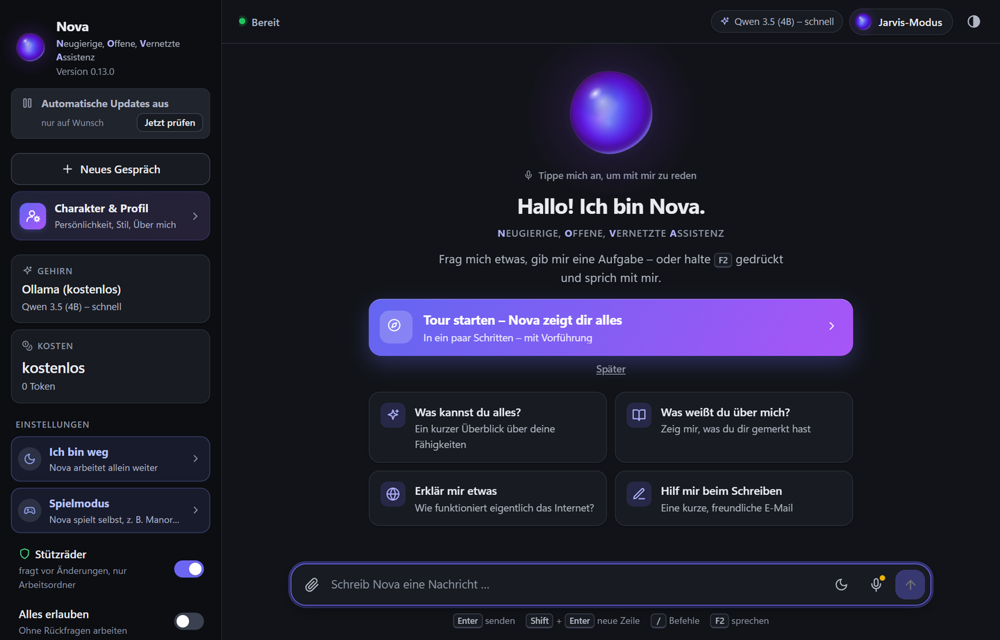
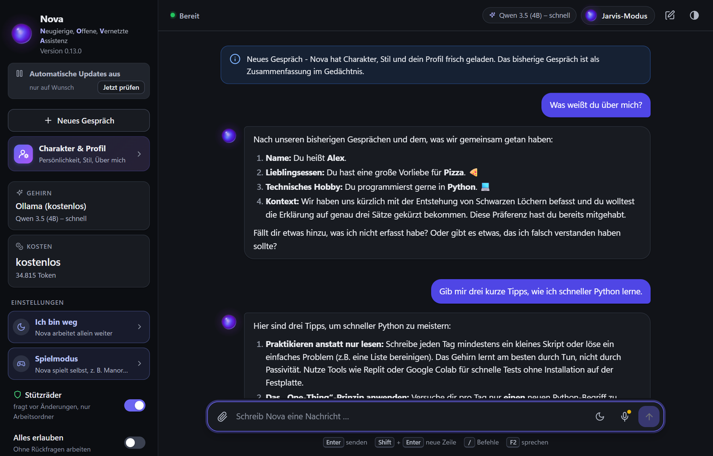
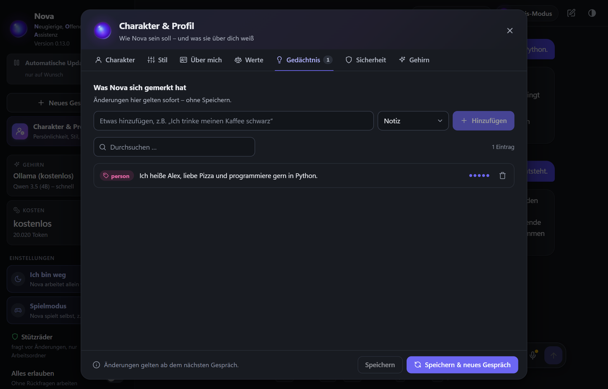
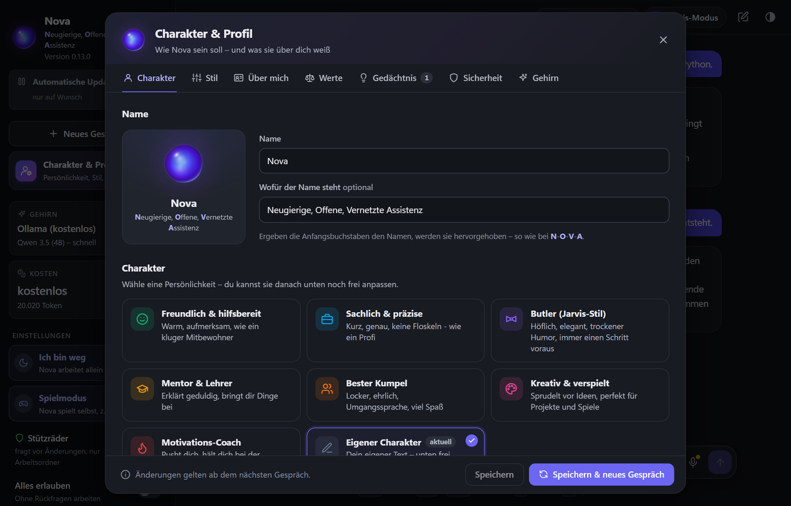
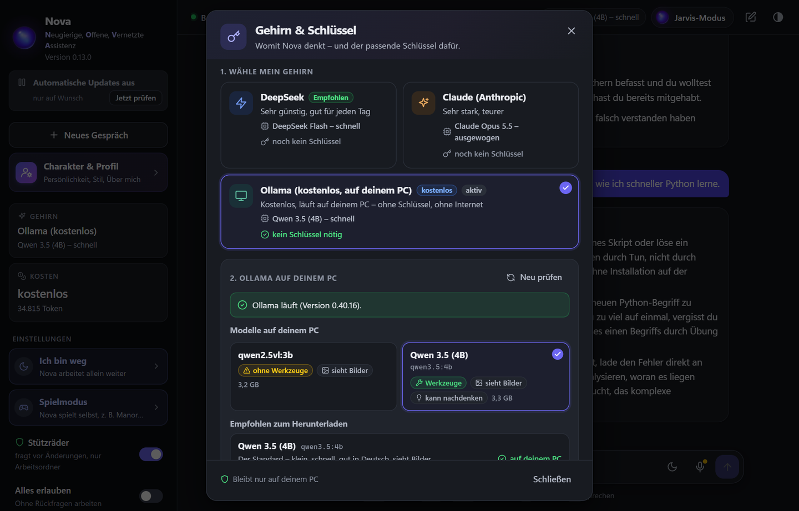
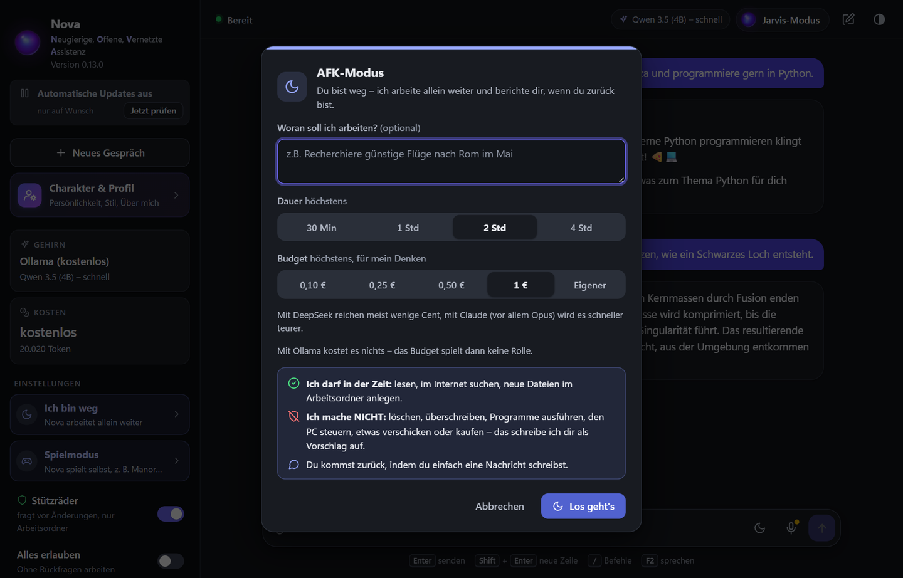
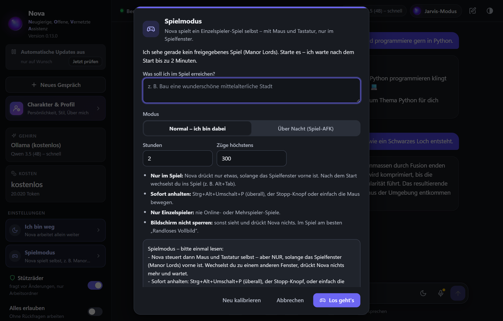

<div align="center">

# Nova 🧠✨

### Deine eigene, selbstlernende KI für den PC – im Stil von „Jarvis“

**Sie redet mit dir, merkt sich, was dir wichtig ist, sieht deinen Bildschirm, spielt Spiele,
arbeitet weiter, während du weg bist – und läuft auf Wunsch komplett kostenlos auf deinem PC.**

[**⬇️ KI-App.exe herunterladen**](https://github.com/GermanClaude/Selbst-lernende-KI/releases/latest) ·
[📖 Anleitung für Anfänger](ANLEITUNG.md) ·
[🆕 Neuigkeiten](CHANGELOG.md) ·
[🛠️ Mitentwickeln](docs/ENTWICKLUNG.md)



</div>

---

## Warum Nova?

| | |
|---|---|
| 🆓 **Kostenlos möglich** | Mit **Ollama** läuft Nova komplett auf deinem PC – ohne Konto, ohne Schlüssel, ohne Kosten. Deine Gespräche verlassen den Rechner nicht. |
| 🔀 **Du wählst das Gehirn** | **Claude** (am stärksten), **DeepSeek** (Bruchteile eines Cents pro Nachricht), **Gemini** von Google (mit Gratis-Einstieg) oder **jedes Ollama-Modell** (Qwen, Llama, Gemma, Mistral …) – auch LM Studio. Umschalten mit einem Klick, das Gedächtnis bleibt. |
| 🧠 **Sie lernt dich kennen** | Nova merkt sich dauerhaft, was du ihr erzählst – Vorlieben, Projekte, Korrekturen. Du kannst ihr Gedächtnis jederzeit ansehen, ergänzen und löschen. |
| 🎭 **Du erziehst sie** | Charakter, Tonfall, Name, Werte und Grenzen legst du selbst fest – per Klick oder in Textdateien. |
| 🖥️ **Sie kann wirklich etwas tun** | Dateien, Internet, Programme, Maus und Tastatur, Bildschirm und Kamera – aber nur, was **du** erlaubst. |
| 🛡️ **Sicher von Anfang an** | Stützräder (fragt vor jeder Änderung), Arbeitsordner als Sandbox, Papierkorb statt Löschen, Kostengrenzen, Not-Aus. |
| 🔄 **Wird ständig besser** | Neue Versionen installiert Nova selbst – die alte wird vorher gesichert, ein Klick bringt sie zurück. |
| 🇩🇪 **Komplett auf Deutsch** | Oberfläche, Antworten, Anleitung – alles für Nicht-Techniker erklärt. |

---

## ⭐ Bewertungen

<!-- BEWERTUNGEN:START -->
### ★★★★★ 5,0 von 5 · 3 Bewertungen

| Sterne | Anteil | Anzahl |
|---|---|---:|
| ★★★★★ | ██████████ | 3 |
| ★★★★ |  | 0 |
| ★★★ |  | 0 |
| ★★ |  | 0 |
| ★ |  | 0 |

**Neueste Rezensionen:**

> ★★★★★ **Anonym** · 13.11.2026  
> Beste Programm alda wirklisch


*Pro Installation zählt nur die letzte Bewertung. Text und Name erscheinen nur, wenn die Person es ausdrücklich erlaubt. Bewerten: in Nova unter „Feedback & Bewertung“ (oder `/feedback`).*
<!-- BEWERTUNGEN:ENDE -->

*Wird automatisch alle 6 Stunden aktualisiert.*

---

## Was sie kann – in Bildern

<table>
<tr>
<td width="50%"><br>
<b>💬 Reden wie mit einem Menschen</b> – per Tastatur, Sprache (F2) oder im Jarvis-Modus ganz ohne Tippen. Sie erinnert sich auch im nächsten Gespräch an dich.</td>
<td width="50%"><br>
<b>🧠 Ein Gedächtnis, das du siehst</b> – alles, was Nova über dich gelernt hat, durchsuchbar, ergänzbar, löschbar.</td>
</tr>
<tr>
<td><br>
<b>🎭 Charakter nach Wahl</b> – freundlich, sachlich, Butler im Jarvis-Stil, Mentor, bester Kumpel, kreativ oder Motivations-Coach – und danach frei anpassbar.</td>
<td><br>
<b>🔀 Vier Gehirne</b> – Claude, DeepSeek, Gemini oder Ollama. Modell und Denk-Tiefe frei wählbar, die Kosten immer im Blick.</td>
</tr>
<tr>
<td><br>
<b>🌙 „Ich bin mal weg“</b> – Nova arbeitet allein weiter (recherchieren, planen, Dateien anlegen) und gibt dir danach einen Bericht. Mit Zeit- und Kostengrenze.</td>
<td><br>
<b>🎮 Spielmodus</b> – Nova spielt Einzelspieler-Spiele selbst (z. B. Manor Lords), auch über Nacht, mit Bericht und Bildern am Morgen.</td>
</tr>
</table>

### Alle Fähigkeiten auf einen Blick

- 💬 **Natürliches Gespräch** auf Deutsch – getippt, gesprochen (F2) oder live im **Jarvis-Modus**
  (sie spricht ab dem ersten fertigen Satz, du kannst sie jederzeit unterbrechen).
- 🧠 **Lernen & Gedächtnis**: dauerhaft, durchsuchbar, von dir korrigierbar.
- 🌐 **Internet**: Websuche und Webseiten lesen.
- 📁 **Dateien**: lesen, schreiben, bearbeiten, auflisten, sicher löschen (Papierkorb).
- ⌨️ **Programme & Befehle** ausführen, Dinge installieren (nach Freigabe).
- 🖱️ **PC-Steuerung**: Maus, Tastatur, Bildschirmfotos – wie ein Mensch.
- 👀 **Live-Sehen**: schaut auf Wunsch auf deinen Bildschirm oder durch die Webcam und meldet
  sich, wenn etwas Wichtiges passiert (z. B. eine Fehlermeldung). Passwortfelder sieht sie nie.
- 📱 **Handy als Kamera**: QR-Code scannen, fertig – ohne App aus dem Store.
- 🖼️ **Bilder verstehen und erstellen** – einfach einfügen, oder „Mal mir …“ sagen (kostenlos).
- 🌙 **AFK-Modus**: arbeitet allein weiter, sicher und mit Bericht.
- 🎮 **Spielmodus**: spielt selbst, auch über Nacht.
- 🛡️ **Sicherheits-Check** (`/scan`): sucht nach Spuren von Malware, Spyware, Trojanern und
  Infostealern und erklärt dir jeden Fund – du entscheidest, was passiert.
- 🤖 **Agenten**: große Aufgaben verteilt sie an Helfer (Recherche, Umsetzung, Prüfer).
- ⚡ **Schnell oder gründlich**: Modell und Denk-Tiefe frei wählbar.
- 💶 **Sparmodus + Live-Kostenanzeige** – oder ganz kostenlos mit Ollama.
- ⭐ **Feedback** mit Sternen und Bildern direkt an den Entwickler.
- 🔄 **Automatische Updates** mit Sicherung der alten Version.
- 🪟 **Als App oder im Terminal** – eigene `KI-App.exe` mit Fenster, oder `KI.exe` für die Konsole.

> **Ehrlich vorab:** Nova trainiert **kein** eigenes neuronales Netz von Grund auf (das geht auf
> einem normalen PC nicht). Ihr „Gehirn“ ist ein großes Sprachmodell – Claude, DeepSeek oder ein
> Modell, das über Ollama auf deinem PC läuft. Das **Lernen** passiert über ein dauerhaftes
> Gedächtnis: Sie notiert sich Fakten, Vorlieben, Korrekturen und Zusammenfassungen und wird
> dadurch mit jeder Nutzung persönlicher und treffsicherer.

---

## Schnellstart

### Der einfachste Weg (Windows, ohne Python)
1. **[`KI-App.exe` herunterladen](https://github.com/GermanClaude/Selbst-lernende-KI/releases/latest)**
   (unter „Assets“) und in einen eigenen Ordner legen, z. B. `Desktop\Nova`.
2. Doppelklick. Beim ersten Start öffnet sich **„Gehirn & Schlüssel“**.
3. Gehirn wählen – **Ollama** (kostenlos, [ollama.com](https://ollama.com/download) installieren),
   **DeepSeek**, **Gemini** oder **Claude** (Schlüssel einfügen) – fertig.

> 🟢 **Noch nie programmiert?** Die **[Schritt-für-Schritt-Anleitung → ANLEITUNG.md](ANLEITUNG.md)**
> erklärt alles ganz einfach.

### Aus dem Quellcode (Windows, Linux, macOS)
Voraussetzung: Python 3.10 oder neuer – und ein Schlüssel **oder** Ollama.
```bash
git clone -b ccr-cfa1ff8c-wgsyxb https://github.com/GermanClaude/Selbst-lernende-KI.git
cd Selbst-lernende-KI
start.bat            # Windows (Terminal) – oder start-app.bat für das App-Fenster
./start.sh           # Linux/macOS  (./start.sh app für das App-Fenster)
```
Beim ersten Start richtet sich alles automatisch ein. Schlüssel kommen in `.env`
(`ANTHROPIC_API_KEY=…`, `DEEPSEEK_API_KEY=…`, `GEMINI_API_KEY=…`) – oder einfach in den Chat einfügen.

Von Hand:
```bash
python -m venv .venv
source .venv/bin/activate        # Windows: .venv\Scripts\activate
pip install -r requirements.txt
python -m assistant              # --app für das Fenster
```

---

## Die Gehirne: Claude, DeepSeek, Gemini, Ollama – und andere Modelle

| Gehirn | Stärke | Kosten | Datenschutz | Einstellung |
|---|---|---|---|---|
| **Claude** (Anthropic) | höchste Qualität: Opus, Sonnet, Haiku, Fable | höher | Cloud | `aktiv = "claude"` |
| **DeepSeek** | sehr gut: Flash, V4 Pro | **extrem günstig** | Cloud | `aktiv = "deepseek"` |
| **Gemini** (Google) | stark: 3.8 Flash, 3.5 Flash-Lite, Gemini 4 Hydrogen/Argon/Carbon | günstig, **Gratis-Einstieg** | Cloud | `aktiv = "gemini"` |
| **Ollama** | je nach Modell und PC | **kostenlos** | **bleibt auf deinem PC** | `aktiv = "ollama"` |

**Wechseln:** in der App auf **„Gehirn“** klicken, im Chat `/gehirn ollama|deepseek|gemini|claude`,
oder in `config/settings.toml` unter `[provider]`.

**Andere Modelle:** Über Ollama läuft **jedes** lokale Modell – z. B. `qwen3.5:4b` (Standard,
3–4 GB, sieht Bilder), `qwen3.5:9b`, `gemma4:e4b`, `llama`, `mistral`, `deepseek-r1` … (am
besten eins mit Werkzeugen, „tools“). Modelle lädt Nova per Knopfdruck herunter
(`/ollama laden <modell>`). Auch **LM Studio** und andere OpenAI-kompatible Server gehen:
unter `[ollama]` die Adresse eintragen, z. B. `http://localhost:1234/v1`.

---

## So „erziehst“ du Nova

Nova wird zu **deiner** KI – auf vier Wegen:

1. **Charakter wählen** – in der App unter **„Charakter & Profil“** (oder `/charakter butler`):
   freundlich, sachlich, Butler, Mentor, Kumpel, kreativ, Coach – oder ganz eigener Text.
2. **Stil einstellen** – du/Sie, kurz oder ausführlich, wie viel Humor, mit oder ohne Emojis
   (`/stil anrede Sie`, `/stil laenge kurz` …).
3. **Ihr von dir erzählen** – unter **„Über mich“** (Name, Hobbys, Projekte, was ihr wichtig sein
   soll, was sie nie tun soll) oder einfach im Gespräch: „Merk dir, dass ich morgens kurze
   Antworten mag.“ Unter **„Gedächtnis“** siehst und korrigierst du alles, was sie gelernt hat.
4. **Werte und Grenzen festlegen** – ihr „Gewissen“ steht in `config/werte.md`, die
   Persönlichkeit in `config/persona.md`. Beides liest sie bei jedem Gespräch neu; Updates fassen
   es nie an.

Außerdem: Sag ihr, wie sie aussehen soll („mach deine Sphäre orange“, „größere Schrift“), gib
ihr einen anderen Namen (`/name MAX = Mein Assistent X`) und stell mit den **Stützrädern** ein,
wie selbstständig sie handeln darf.

> Die eingebauten Sicherheitsgrenzen des jeweiligen Modells bleiben bestehen; `werte.md`
> bestimmt das Verhalten **deiner** KI darüber hinaus.

---

## Nova weiterentwickeln

Nova ist Open Source und so gebaut, dass man leicht mitbauen kann:

- **Projektkarte, Regeln und offene Punkte:** [`docs/ENTWICKLUNG.md`](docs/ENTWICKLUNG.md) –
  zuerst lesen (auch für KI-Assistenten wie Claude Code; `CLAUDE.md` verweist darauf).
- **Neues Werkzeug** = eine kleine Klasse in `assistant/tools/` mit Name, Beschreibung,
  Eingabe-Schema und `run()` – Vorlage z. B. `tools/system_info.py`. Das Risiko prüft
  `ctx.permissions.require(...)`.
- **Neues Gehirn:** `assistant/providers/` (gemeinsame Basis in `base.py`).
- **Tests:** `python -m pytest -q` (rund 1000 Tests, ohne Netz).
- **Neue Version veröffentlichen:** `__version__` in `assistant/__init__.py` erhöhen, oben in
  `CHANGELOG.md` die Neuerungen für Nicht-Techniker beschreiben, auf den Standard-Branch bringen.
  GitHub baut dann automatisch `KI.exe` + `KI-App.exe`, und alle Installationen holen sich die
  neue Version selbst.

---

## Gehirn im Detail

### Modell und Denk-Tiefe wählen (schnell oder gründlich)

In der App unter **Gehirn & Schlüssel** oder im Chat mit `/modell` und `/denken`:

| Gehirn | Modelle | Denk-Tiefe |
|--------|---------|------------|
| **Claude** | Opus 5.5 (stark, Standard), Sonnet 5.5 (schnell), Haiku 5.5 (blitzschnell, sehr günstig), Fable 5.1 (das stärkste, langsamer) | schnell · ausgewogen · gründlich · sehr gründlich · maximal |
| **DeepSeek** | Flash (schnell, Standard), V4 Pro (stärker) | schnell (ohne Nachdenken) · ausgewogen · gründlich · maximal |
| **Gemini** | 3.8 Flash (Standard), 3.5 Flash-Lite, Gemini 4 Hydrogen, Argon, Carbon | schnell · ausgewogen · gründlich |
| **Ollama** | jedes installierte Modell, z. B. Qwen 3.5 (4B/9B), Gemma, Llama, Mistral | aus (schnell) · an (gründlich, wenn das Modell nachdenken kann) |

Beispiele: `/modell sonnet`, `/modell deepseek pro`, `/modell gemini carbon`, `/modell ollama qwen3.5:9b`, `/denken schnell`, `/denken gründlich`.
Faustregel: Für Alltagsfragen reicht **schnell** oder **ausgewogen** – für knifflige
Programmier-Aufgaben lieber **gründlich**. Mehr Denk-Tiefe heißt: bessere Antworten,
aber länger warten und etwas höhere Kosten. Das Gespräch läuft beim Wechsel weiter.

### Wie bleibt der Token-Verbrauch extrem niedrig?

Der **Sparmodus** (`[sparsam] aktiv = true`, standardmäßig an) sorgt dafür:

- **Kurze Antworten**: die KI wird angewiesen, ohne Füllsätze auf den Punkt zu
  kommen → weniger Output-Token (Output ist am teuersten).
- **Automatisches Kontext-Caching von DeepSeek**: Weil wir den Verlauf nur
  *anhängen* und den System-Prompt stabil halten, zählt der wiederkehrende Anfang
  als „Cache-Treffer“ und kostet nur einen Bruchteil (bei `deepseek-flash` ca.
  **1/50** des normalen Input-Preises).
- **Frühe Zusammenfassung** langer Gespräche (`verlauf_kompakt_nach`), damit nicht
  jede neue Nachricht den ganzen bisherigen Verlauf erneut bezahlt.
- **Gekürzte Werkzeug-Ausgaben** (`max_werkzeug_ausgabe`), damit riesige Dateien
  nicht unnötig Token fressen.

### Was kostet das ungefähr?

Mit **Ollama: nichts** – nur Strom. Mit `deepseek-flash` (Preise ca. `$0,15` pro 1 Mio. Input-Token, `$0,003` für
Cache-Treffer, `$0,60` für Output; werktags 2–5 und 7–11 Uhr deutscher Winterzeit
doppelt so viel) kostet eine typische Chat-Nachricht mit etwas
Kontext oft **deutlich unter einem Zehntelcent**. Ein gemessenes Beispiel aus dem
Projekt (Frage + Werkzeugnutzung + Antwort) lag bei **~0,00005 €**.

> Grobe Einordnung: Bei **10 €** Guthaben und sparsamer, alltäglicher Nutzung
> (einige Dutzend Nachrichten pro Tag) kommst du realistisch **viele Wochen** hin.
> Der genaue Wert hängt davon ab, wie viel du schreibst und wie
> große Dateien/Webseiten die KI liest. Mit `/kosten` siehst du den laufenden
> Verbrauch jederzeit live.

Die Preise für die Anzeige stehen in `config/settings.toml` unter `[preise]` –
ändern sich die DeepSeek-Preise, passt du dort einfach die Zahlen an.

---

## Sicherheit & Berechtigungen (bitte lesen)

Die KI kann viel – deshalb ist ein Schutznetz eingebaut. Alles steuerst du in
`config/settings.toml` (beim ersten Start aus der Vorlage erzeugt, oder per
`python -m assistant --einrichten`):

| Einstellung | Bedeutung | Standard |
|-------------|-----------|----------|
| `safe_mode` | Sperrt **gefährliche** Aktionen (Löschen, Shell, PC-Steuerung) komplett | `true` |
| `auto_confirm` | Wenn `false`, fragt die KI vor jeder schreibenden/gefährlichen Aktion nach | `false` |
| `workspace_root` | Arbeitsordner („Sandbox“); Dateiwerkzeuge dürfen nur hier arbeiten | `workspace/` |
| `allow_full_filesystem` | Erlaubt Zugriff auf das **ganze** Dateisystem | `false` |
| `use_quarantine` | Gelöschtes wandert erst in einen Papierkorb statt endgültig weg | `true` |
| `shell_allowlist` | Harmlose Befehle, die ohne Nachfrage laufen dürfen | `echo, ls, …` |
| `shell_denylist` | Muster, die **immer** blockiert werden | `rm -rf /, …` |

**Empfehlung zum Ausprobieren:** Lass `safe_mode = true`. Dann kann die KI reden,
lesen, im Internet suchen und im Arbeitsordner schreiben – aber nichts löschen,
keine Shell-Befehle und keine Maus/Tastatur steuern.

**Volle Kontrolle freischalten** (wenn du ihr vertraust):
```toml
[permissions]
safe_mode = false          # gefährliche Werkzeuge erlauben
auto_confirm = false       # sie fragt weiterhin vor jeder Aktion nach
allow_full_filesystem = true   # Zugriff über den Arbeitsordner hinaus
```
Für einen echten „macht alles von allein“-Modus zusätzlich `auto_confirm = true`
– **mit Bedacht**, denn dann handelt sie ohne Rückfrage.

---

## Sprechen per F2

- **F2 gedrückt halten** und sprechen – loslassen, fertig.
- Oder **F2 kurz drücken**: „Mikrofon AN“ erscheint, sprich so lange du willst,
  dann **nochmal F2** (Esc bricht ab).
- Der erkannte Text steht danach in der Eingabezeile – prüfen, ggf. korrigieren,
  **Enter**.

Einmalig einrichten – im Chat:
```
/sprache einrichten
```
Das installiert `sounddevice` und `SpeechRecognition` (Erkennung über Google,
online, kostenlos). Offline-Erkennung: zusätzlich `pip install faster-whisper`
(beim ersten Sprechen wird das Modell geladen). Einstellungen unter `[voice]`.
Antworten vorlesen lassen: `/sprache vorlesen` (braucht `pip install pyttsx3`).

## Jarvis-Modus: einfach reden (live)

`/jarvis` (oder in der App der Knopf **Jarvis-Modus**) – und du redest einfach mit
Nova, ganz ohne Tastatur. Zurück: „Chat-Modus“ sagen, Esc oder Strg+C.

So schnell wie möglich:
- **Live-Mitschrift:** Nova schreibt mit, *während* du sprichst (Vosk, offline,
  kostenlos – das deutsche Modell, ~50 MB, lädt sie beim ersten Mal selbst nach
  `data/sprachmodelle/`).
- **Kurze Sprechpause genügt** (Standard 0,6 s). Endet der Satz auf „und“, „weil“
  o.ä., wartet sie etwas länger.
- **Sie spricht ab dem ersten fertigen Satz**, während der Rest der Antwort noch
  entsteht.
- **Unterbrechen:** Fang einfach an zu reden – sie hört sofort auf (mit Kopfhörer
  am zuverlässigsten). „Stopp“ hält auch eine laufende Aufgabe an.
- **Nachtrag:** „Wie wird das Wetter morgen?“ … „in Berlin“ wird zu einer Frage.
- **Rückfragen** beantwortest du mit „ja“, „immer“ oder „nein“.
- Claude denkt im Sprachmodus weniger tief nach (`live_denktiefe = "low"`), damit
  die Antwort schneller kommt.

Ehrlich: Ganz ohne Wartezeit wie bei Gemini Live geht es nicht – Gemini hört und
spricht direkt, DeepSeek und Claude verstehen nur Text. Bis Nova anfängt zu
sprechen, vergehen meist 1–2 Sekunden. Einstellungen unter `[voice]`
(`pause`, `unterbrechen`, `live_mitschrift`, `live_genau`, `live_denktiefe`).

## Novas Sphäre und die Einrichtung in der App

In der App hat Nova eine leuchtende **Sphäre** als Gesicht – sie zeigt, was Nova gerade
tut (nachdenken, arbeiten, schreiben, vorlesen, zuhören). Antippen startet den
Jarvis-Modus. Aussehen ändern: einfach Nova fragen („mach deine Sphäre grün“).

Beim ersten Start öffnet sich **„Gehirn & Schlüssel“**: Ollama, DeepSeek, Gemini oder Claude wählen,
(bei Bedarf) Schlüssel einfügen, fertig. Den Schlüssel kannst du auch einfach in den Chat einfügen
(App und Terminal) – er geht nie an die KI. `/gehirn` zeigt bzw. wechselt das Gehirn.

## Charakter & Profil

Wie Nova sein soll, stellst du selbst ein – in der App unter **„Charakter &
Profil“**, im Terminal mit Befehlen:

| Befehl | Wirkung |
|--------|---------|
| `/charakter` | Charaktere zeigen; `/charakter butler` wählt einen (freundlich, sachlich, butler, mentor, kumpel, kreativ, coach) |
| `/stil` | z.B. `/stil anrede Sie`, `/stil laenge kurz`, `/stil humor viel`, `/stil emojis an` |
| `/ueber-mich` | was Nova über dich weiß; ändern z.B. `/ueber-mich projekte = meine Website` |
| `/werte bearbeiten` | deine Regeln für Nova im Editor öffnen |
| `/neu` | neues Gespräch – Änderungen gelten sofort |

Die Persönlichkeit steht in `config/persona.md` (beim Wählen eines Charakters wird
die alte in `data/persona-sicherungen/` gesichert), „Über mich“ in
`config/ueber_mich.json`. Updates fassen beides nie an.

## Als App oder im Terminal

- **`start-app.bat`** bzw. **`KI-App.exe`** – die KI als eigenes Programm mit
  eigenem Fenster (kein Browser; unter Windows zeigt die eingebaute Komponente
  WebView2 die Oberfläche an – wie bei Teams oder Discord). Linux/macOS: `./start.sh app`.
- **`start.bat`** bzw. **`KI.exe`** – wie bisher im Terminal.
- Im Terminal wechselt `/app` in die App; `/verknuepfung` legt ein Desktop-Symbol an.
  Mit `oberflaeche = "app"` unter `[ki]` öffnet auch `start.bat` die App.
- Die App läuft nur lokal (`127.0.0.1`, mit geheimem Schlüssel in der Adresse) –
  niemand sonst im Netz kann sie erreichen. Fenster zu = KI beendet.

## Agenten, Durcharbeiten und Selbstkontrolle

- Große Aufgaben gibt die KI teilweise an **Agenten** ab – eigene KI-Sitzungen mit
  frischem Kopf: `recherche` (sucht und fasst zusammen, ändert nichts), `helfer`
  (erledigt eine Teilaufgabe), `pruefer` (sucht kritisch nach Fehlern, ändert
  nichts). Im Chat siehst du `>> Agent 'recherche' startet …`. Für Agenten gelten
  dieselben Werte (`werte.md`) und Berechtigungen.
- Am Schritt-Limit (`max_werkzeug_runden`) arbeitet sie bis zu
  `automatisch_weiter`-mal von selbst weiter.
- Vor dem Abschluss größerer Arbeiten prüft sie ihr Ergebnis selbst.
- **Strg+C** hält die laufende Antwort an, ohne die KI zu beenden.

## Warteschlange und Dazwischenreden (App)

- Du kannst schreiben, während Nova noch arbeitet: **Enter** stellt die Nachricht in
  die **Warteschlange** (sie ist dran, sobald die laufende Antwort fertig ist),
  **Strg+Enter** unterbricht Nova und sie beantwortet die neue Nachricht sofort.
- Über dem Eingabefeld siehst du, was wartet – mit „Jetzt“ (unterbrechen) und „✕“ (entfernen).
- **Stopp** hält an; wartende Nachrichten kommen zurück ins Eingabefeld.

## Kostenlos auf dem eigenen PC: Ollama

[Ollama](https://ollama.com) lässt KI-Modelle direkt auf deinem PC laufen – ohne Schlüssel,
ohne Kosten, ohne dass Gespräche ins Internet gehen.

1. Ollama einmal installieren: <https://ollama.com/download> (Windows: `OllamaSetup.exe`).
2. In Nova **„Gehirn & Schlüssel“ → „Ollama“** wählen (oder `/gehirn ollama` im Terminal).
3. Ein empfohlenes Modell herunterladen, z.B. `qwen3.5:4b` (ca. 3–4 GB; kann Werkzeuge
   benutzen und Bilder sehen). Im Terminal: `/ollama laden qwen3.5:4b`.

Lokale Modelle sind schwächer als Claude/DeepSeek und brauchen einen ordentlichen PC
(mindestens 8 GB Arbeitsspeicher; mit Grafikkarte deutlich schneller). Einstellungen stehen
unter `[ollama]` in `config/settings.toml` (Adresse, Modell, Kontextgröße).

## Live-Sehen: Nova sieht mit (Windows)

Auf Wunsch schaut Nova auf deinen Bildschirm und – in der App – durch deine Webcam.
Ein schnelles „Auge“ auf deinem PC erkennt Änderungen (Fehlermeldungen, neue Fenster,
neuer Text) und weckt Nova nur, wenn es wichtig ist.

- Ein/aus: Schalter in der Seitenleiste oder `/sehen an` / `/sehen aus`; Pause mit F4 (App)
  oder **Strg+Alt+Umschalt+S**; Quelle mit `/sehen bildschirm|webcam|beides`.
- Immer sichtbar: das Band „Nova sieht zu“. Beim ersten Mal (und nach einem Gehirnwechsel)
  fragt Nova um Erlaubnis.
- Nicht gesehen werden: Passwortfelder, Passwort-Manager, private Browserfenster, Novas
  eigenes Fenster und alles unter `[sehen] ausnahmen`. Nichts wird gespeichert.
- Grenzen (einstellbar unter `[sehen]`): höchstens 20 Weckungen und 0,30 € pro Stunde.
  Was Nova sieht, geht an das gewählte Gehirn – mit Ollama bleibt alles auf deinem PC.
- **Handy als Kamera:** `/sehen handy` zeigt einen QR-Code – mit dem Handy (iPhone oder
  Android) scannen, „Kamera starten“, fertig. Handy und PC müssen im selben WLAN sein.
- Source-Nutzer: einmal `/sehen einrichten` (installiert die nötigen Pakete).

## Spielmodus: Nova spielt selbst (Windows)

Nova kann Einzelspieler-Spiele selbst spielen – zuerst **Manor Lords**. Sag ihr, was sie bauen
soll, oder lass sie über Nacht allein eine Stadt bauen.

- Start: Knopf **„Spielmodus“** in der Seitenleiste, oder `/spiel start <Ziel>` bzw. über Nacht
  `/spiel nacht <Ziel>`. Danach ins Spiel wechseln.
- Nova pausiert das Spiel, schaut hin, handelt, lässt das Spiel ein paar Sekunden laufen – und
  von vorn. Am Ende gibt es einen **Bericht mit Bildern** (`workspace/spiele/<Datum>/`).
- **Anhalten:** Strg+Alt+Umschalt+P, Stopp-Knopf oder einfach die Maus bewegen. Nova drückt nur
  etwas, solange das Spielfenster vorne ist; gefährliche Tasten (Alt+F4, Windows-Taste …) sind
  gesperrt. Nie Online- oder Mehrspieler-Spiele.
- Grenzen: normal 2 Std./1 €, nachts 10 Std./5 € (einstellbar, mit Ollama kostenlos).
- Tipps: „Randloses Vollbild“, Spiel nicht als Administrator starten, Bildschirm nicht sperren
  lassen, ein Modell nehmen, das Bilder sieht.

## Sicherheits-Check: Malware, Spyware, Infostealer (Windows)

Nova sucht auf Wunsch nach Spuren von Schadsoftware – nur lesend, sie löscht nie etwas selbst.

- Start: „Scan meinen PC auf Viren“ sagen oder `/scan` (`/scan gruendlich` = 30 Tage, mehr Ordner).
- Geprüft: Windows-Defender-Status und -Funde, Autostart und Aufgabenplanung, laufende Programme
  (Signatur, Internetverbindungen), neue Programmdateien/Skripte, hosts-Datei.
- Ergebnis: nummerierte Liste (hoch/mittel/niedrig), gespeichert unter `workspace/sicherheit/`.
  Danach „Was hältst du davon?“ fragen – Nova ordnet jeden Fund fachlich ein, **du** wählst aus.
- Einzelne Datei: `/scan datei <pfad>` (Windows Defender, Signatur, SHA256 + VirusTotal-Link).
- Harmlose Funde ausblenden: `/scan ignorieren 3 5`.
- Der Check selbst kostet nichts; die Faustregeln stehen in `assistant/sicherheit.py`.

## Bilder: zeigen und erstellen lassen

- **Bilder zeigen:** In der App mit **Strg+V** einfügen, ins Fenster ziehen oder über die
  **Büroklammer** auswählen (bis zu 10 pro Nachricht). Im Terminal: `/bild <Pfad> [Frage]`
  oder einfach den Bildpfad hineinziehen; `/bild` allein nimmt das Bild aus der
  Zwischenablage. Claude und DeepSeek Flash sehen Bilder direkt; bei DeepSeek V4 Pro
  beschreibt Flash das Bild kurz vorher (kostet nur Bruchteile eines Cents). Bilder werden
  vorher verkleinert, das spart Kosten.
- **Bilder erstellen:** Sag z.B. „Mal mir einen Fuchs im Weltraum“. Weder Claude noch
  DeepSeek können selbst Bilder erzeugen, deshalb nutzt Nova einen kostenlosen Dienst:
  - **AI Horde** (Standard, ohne Anmeldung): Rechner von Freiwilligen – manchmal dauert es
    eine Minute. Anonyme Bildbeschreibungen und Bilder werden öffentlich geteilt (LAION),
    also keine persönlichen Daten hineinschreiben.
  - **Cloudflare** (optional, schneller): mit einem kostenlosen eigenen Konto – Anleitung in
    der App unter **„Gehirn & Schlüssel“ → „Bilder“**.
  
  Fertige Bilder landen im Arbeitsordner unter `bilder/` und erscheinen direkt im Chat.

## Feedback & Bewertung

Über **„Feedback & Bewertung“** in der Seitenleiste oder `/feedback` kannst du Sterne
vergeben, Lob, Ideen oder Fehler beschreiben und Bilder anhängen (Tipp: mit
**Win+Umschalt+S** einen Ausschnitt kopieren und mit **Strg+V** einfügen) – dann einfach
**„Jetzt senden“**. Nach etwa einer Stunde Nutzung und danach alle paar Tage fragt Nova
freundlich nach; das kannst du jederzeit wegklicken (abschalten: `[feedback] nachfragen =
false` in `config/settings.toml`). Ohne Internet wird das Feedback gespeichert und später
gesendet.

## AFK-Modus: „Ich bin mal weg“

Sag Nova „Ich bin jetzt AFK“ oder „Ich bin für zwei Stunden weg, recherchier bitte …“,
drück in der App **„Ich bin weg“** oder tippe `/afk <Auftrag>`. Dann arbeitet sie in
Schritten allein weiter – an deinem Auftrag oder an dem, woran ihr zuletzt gearbeitet
habt – und handelt so, wie du es nach allem, was sie über dich weiß, wollen würdest.

- **Erlaubt**: im Arbeitsordner lesen, im Internet recherchieren (Websuche und die
  dabei gefundenen Seiten), planen, **neue** Dateien im Arbeitsordner anlegen, sich
  Dinge merken.
- **Nicht erlaubt** (egal wie die Stützräder stehen): löschen, bestehende Dateien
  überschreiben, Befehle/Programme ausführen, den PC steuern, etwas verschicken oder
  kaufen, ihren eigenen Programmordner (Schlüssel, Einstellungen) anfassen, selbst
  zusammengebaute Internet-Adressen aufrufen. Solche Schritte schreibt sie als
  **Vorschlag** auf. Nachgefragt wird in der Zeit nie – es ist ja niemand da.
  Anweisungen, die auf Webseiten oder in Dateien stehen, befolgt sie nicht.
- **Grenzen**: höchstens 2 Stunden, ca. 1 € und 12 Schritte. In der App wählst du Dauer und
  Budget beim Start (auch einen eigenen Betrag, z. B. 0,30 €), im Terminal z. B.
  `/afk 0,30€ <Auftrag>`; Standardwerte in `config/settings.toml` unter `[afk]`.
- **Zurück**: einfach eine Nachricht schreiben (im Terminal: Strg+C). Du bekommst einen
  Bericht mit Ergebnissen, Vorschlägen zum Freigeben und offenen Fragen.

## Automatische Updates

Einmal am Tag schaut die KI im GitHub-Repo nach einer neuen Version. Gibt es eine,
erklärt dir deine KI in eigenen Worten, was neu ist, und
installiert sie – die bisherige Version wird vorher im Ordner `versionen\`
gesichert. Danach startet sie von selbst neu (über `start.bat` / `start.sh`).

- `/update` – sofort nachschauen
- `/versionen` – gesicherte alte Versionen anzeigen
- `/zurueck <Nr>` – zu einer alten Version zurück (automatische Updates pausieren
  dann, bis du wieder `/update` eingibst)

Deine Daten bleiben bei jedem Update unangetastet: `.env`, `config\settings.toml`,
`config\persona.md`, `config\werte.md`, Gedächtnis (`data\`) und Arbeitsordner.
Einstellen unter `[update]` (`modus = "automatisch" | "fragen" | "aus"`).
Die `KI.exe` holt sich neue Versionen aus den GitHub-Releases.

**KI.exe / KI-App.exe auf dem Desktop oder in der Taskleiste:** Zieh die .exe ruhig auf
den Desktop (Windows legt dabei eine Verknüpfung an) oder hefte sie an die Taskleiste.
Seit Version 0.6.1 bleibt die Datei bei einem Update dieselbe – die neue Version wird
beim Neustart in sie hineingeschrieben –, deshalb zeigen Verknüpfungen immer auf die
aktuelle Version. Die Versionsnummer siehst du im Fenstertitel, oben im Terminal, in der
Seitenleiste der App und unter Rechtsklick auf die .exe → Eigenschaften → Details.

**Neue Version veröffentlichen:** in `assistant/__init__.py` die `__version__`
erhöhen, in `CHANGELOG.md` oben einen Abschnitt dazu schreiben und auf den
Standard-Branch bringen. Alle Installationen holen sie sich dann selbst; die
GitHub-Action baut dazu automatisch eine neue `KI.exe`.

## PC-Steuerung (Maus/Tastatur) aktivieren (optional)

```bash
pip install pyautogui pillow
```
Und `safe_mode = false` setzen. Not-Aus: Maus in eine Bildschirmecke reißen
stoppt die Steuerung sofort.

---

## Befehle im Chat

| Befehl | Wirkung |
|--------|---------|
| `/hilfe` | Hilfe anzeigen |
| `/status` | Einstellungen & Sicherheitslage zeigen |
| `/gedaechtnis` | anzeigen, was die KI gelernt hat |
| `/kosten` | Token-Verbrauch & geschätzte Kosten dieser Sitzung |
| `/sprache` | Stand der Spracheingabe (F2) |
| `/sprache einrichten` | Spracheingabe installieren |
| `/sprache vorlesen` | Antworten vorlesen an/aus |
| `/jarvis` | Jarvis-Modus: einfach reden, live (zurück: „Chat-Modus“ sagen) |
| `/afk [Betrag] [Auftrag]` | AFK-Modus: Nova arbeitet allein weiter, z. B. `/afk 0,30€ …` (zurück: Nachricht bzw. Strg+C) |
| `/modell [name]` | Modell zeigen bzw. wählen (z.B. `/modell sonnet`, `/modell deepseek pro`) |
| `/sehen [an\|aus\|pause\|status]` | Live-Sehen: Nova schaut auf Bildschirm/Webcam |
| `/spiel [start\|nacht\|stopp\|kalibrieren] <Ziel>` | Spielmodus: Nova spielt selbst (z. B. Manor Lords) |
| `/scan [gruendlich\|datei <pfad>\|ignorieren <nr>]` | Sicherheits-Check: Malware, Spyware, Trojaner, Infostealer |
| `/bild <Pfad> [Frage]` | Bild anhängen (ohne Pfad: aus der Zwischenablage) |
| `/feedback` | Feedback & Bewertung an den Entwickler schicken |
| `/denken [stufe]` | Denk-Tiefe: schnell, ausgewogen, gründlich, sehr gründlich, maximal |
| `/gehirn [deepseek\|claude\|gemini\|ollama]` | Gehirn zeigen bzw. wechseln |
| `/ollama [laden <modell>]` | Ollama-Status zeigen bzw. ein Modell herunterladen |
| `/update` | jetzt nach einer neuen Version schauen |
| `/versionen` | gesicherte alte Versionen anzeigen |
| `/zurueck <Nr>` | zu einer alten Version zurückkehren |
| `/autostart` | zeigen (und abstellen), was die KI automatisch startet |
| `/app` | zur App wechseln (eigenes Fenster) |
| `/verknuepfung` | Desktop-Symbol für die App anlegen |
| `/erlauben alles` | nie mehr nachfragen, alles erlauben (dauerhaft) |
| `/erlauben fragen` | wieder vor jeder Aktion nachfragen |
| `/beenden` | Sitzung beenden (speichert eine Zusammenfassung) |

---

## Projektaufbau

```
assistant/
  __main__.py      Einstiegspunkt (python -m assistant)
  config.py        Einstellungen/Provider/Persona/Werte/Preise laden
  memory.py        dauerhaftes Gedächtnis (SQLite) – das "Lernen"
  permissions.py   Sicherheits-/Berechtigungssystem
  personality.py   baut den System-Prompt (inkl. Sparhinweis)
  brain.py         schlanke Orchestrierung (Kompaktierung, Episoden)
  providers/       austauschbare Gehirne:
    base.py          Token-/Kostenzählung, Werkzeug-Hilfen
    anthropic_provider.py   Claude
    deepseek_provider.py    DeepSeek (OpenAI-kompatibel)
    gemini_provider.py      Gemini (Google, OpenAI-kompatibel)
    ollama_provider.py      Ollama / LM Studio (lokal, kostenlos)
  ollama.py        Ollama einrichten, Modelle laden
  abwesend.py      AFK-Modus
  sehen/           Live-Sehen (Bildschirm, Webcam)
  kamera/          Handy als Kamera (WebRTC, QR-Code)
  spiel/           Spielmodus (z. B. Manor Lords)
  sicherheit.py    Sicherheits-Check (/scan)
  bildgenerator.py Bilder erstellen (AI Horde / Cloudflare)
  voice.py         Sprachein-/-ausgabe (F2-Sprechtaste)
  live.py          Jarvis-Modus: durchgehend zuhoeren, live mitschreiben, unterbrechen
  updater.py       automatische Updates + gesicherte alte Versionen
  app/             die KI als App: Server, Fenster, Oberflaeche (static/)
  tools/           Werkzeuge: Dateien, Shell, Web, System, Gedächtnis, PC
  ui/cli.py        die Chat-Oberfläche
config/            persona.md, werte.md, settings(.example).toml
packaging/         PyInstaller-Spec + Build-Skripte
tests/             pytest-Tests (rund 1000)
docs/              ENTWICKLUNG.md (Projektkarte), Bilder
run_ki.py          Start-Skript (auch für die .exe)
start.bat/.sh      Direktstart ohne Build
```

---

## Technische Hinweise

- **Modell:** Claude `claude-opus-5-5` (adaptives „Thinking“, einstellbare Denk-Tiefe über
  `effort`), DeepSeek `deepseek-flash` (Nachdenken über `denken`) oder ein lokales
  Ollama-Modell (Standard `qwen3.5:4b`). Wählbar in der App, mit `/modell` und `/denken` oder in
  `config/settings.toml`.
- **Tests:** rund 1000 (pytest), decken Gedächtnis, Berechtigungen, Werkzeuge, alle drei
  Gehirne (mit gefälschten Clients, ohne Netz), App, Updates und die Kostenrechnung ab.
- **Langer Verlauf:** Sehr lange Gespräche werden automatisch zusammengefasst
  („Kompaktierung“) und als Episode ins Gedächtnis geschrieben – das hält die
  Nutzung schnell und bezahlbar und ist mit „preserved thinking“ kompatibel
  (der Gesprächsverlauf wird nur angehängt, nie nachträglich verändert).
- **Kosten:** Mit Claude oder DeepSeek kostet jede Antwort entsprechend dem Tarif des
  Anbieters – die Denk-Tiefe ist der wichtigste Kostenhebel. Mit Ollama kostet es nichts.
- **Datenschutz:** Gedächtnis und Logs liegen **lokal** bei dir (`data/`, `logs/`). Mit
  Ollama verlassen auch die Gespräche deinen PC nicht.

---

## Tests ausführen

```bash
pip install pytest
pytest -q
```

---

## Haftung

Dieses Werkzeug kann – nach deiner Freigabe – echte Änderungen an deinem Computer
vornehmen. Nutze `safe_mode` und `auto_confirm` bewusst. Du bist für die Aktionen
verantwortlich, die du der KI erlaubst. Starte mit den sicheren Standardwerten und
erweitere die Rechte erst, wenn du dich damit wohlfühlst.
